# Kinetta app map

The pre-launch walkthrough (#472) builds this map one tab at a time. Me was inspected at `8cb2c01`, and Home and Track at `7d0b3d6`. #421 updates the first-Goal entrance and folds milestones into the card. Track’s native recording and Health visuals used browser stand-ins; physical-device behavior is not verified. Progress was inspected at `fe929ab`; Nutrition and sign-up at `9e94178` (identical application code, with the intervening map update). Prepared enrollment, recovery, Terms and native welcome states are labelled below; they do not establish email delivery, consent, installation or device behavior. Routes use placeholders and contain no account data.

Depth counts taps after selecting the tab. Opening a disclosure and then its Open link counts as two taps. Sheet depth is included. Scrolling does not add taps. A node can have several entrances; depths below use the shortest entrance available in the inspected state.

## Home-first tabs and the Me card

The boundary nodes lead to other tabs; their owned flows appear below as each slice is reviewed.

```mermaid
flowchart LR
  Tabs["Five tabs"] --> Activity["Home · /activity · see audited feed below"]
  Tabs --> Progress["Progress · see audited flow below"]
  Tabs --> Track["Track · see audited flow below"]
  Tabs --> Nutrition["Nutrition · see audited flow below"]
  Tabs --> Me["Me · see audited private dashboard below"]
  Signup["Sign-up and welcome · see flow below"]

  Me -->|Settings icon · 1| Settings["Settings · /me/settings"]
  Me -->|Avatar or shared count · 1| Profile["Your full profile · /people/:username"]
  Me -->|Friends · 1| Friends["Friends · /me/friends"]
  Me -->|Bell · 1| Inbox["Notification inbox · /notifications"]
  Me -->|All your activities · 1| History["Your activities · /me/activities"]
  Me -->|Shoes and bikes · 1| Gear["Shoes and bikes · /me/gear"]
  Me -->|Goals Edit · 1 when goals exist| Goals["Goals · /me/goals"]
  Me -->|Latest milestone · 1 when present| MilestoneShare["Share milestone sheet"]
  Me -->|See all milestones · 1 when present| MilestoneList["Recent milestones sheet"]
  Me -->|Set a goal · 1 when empty| GoalEdit
  MilestoneLegacy["Legacy /me/milestones"] -.-> Me
  Track -->|Explore · 1| Explore["Explore Kinetta · /me/explore (legacy URL)"]
  Me -->|Edit · 1| Editor["Inline card editor"]
  Me -->|Share · 1| ShareMenu["Share your profile sheet"]
  Me -->|Monthly recap Share · 1 when present| Recap["Share progress sheet"]
  Me -->|Weekly review disclosure · 1| Week["Your week in review · inline"]
  Me -->|Optional profile setup · 1| Signup
  Me -->|Training plan or View plan · 1| Plan["Training plan · /plan"]
  Me -->|View progress or Fitness · 1| Progress
  Me -->|Open food log or Food review · 1| Nutrition
  Me -->|Log food · 1| AddFood["Add food · /food/describe"]
  Me -->|Nutrition goal · 1| FoodSetup["Nutrition goal · /food/setup"]
  Me -->|Today workout or personal best · 1| Detail["Activity detail · /activity/:id"]
  Me -->|Optional connection setup · 1| Connections["Connections · /track/connections"]
  Me -->|Record an activity · 1| Track
  Me -->|Help| Mail["Help and contact · email link"]

  Settings -->|Name · 2| Name["Name sheet"]
  Settings -->|Username · 2| Username["Username sheet"]
  Settings -->|Email · 2| Email["Email sheet · setup-dependent"]
  Settings -->|Password · 2| Password["Change password sheet"]
  Settings -->|Edit profile · 2| Editor
  Settings -->|Body and heart rate · 2| Body["Body, heart rate and time-zone sheet"]
  Body -->|Log · 3| Weight["Weigh-in sheet"]
  Settings -->|Signed-in devices · 2| Devices["Signed-in devices · /me/devices"]
  Devices -->|Sign out one or others · 3| SignoutConfirm["Device sign-out confirmation"]
  Settings -->|Sharing and privacy · 2| Privacy["Sharing and privacy · /me/sharing"]
  Privacy -->|Segment leaderboards · 3| SegmentConsent["Segment leaderboard consent sheet"]
  Settings -->|Notifications · 2| NoticePrefs["Notification preferences · /me/notifications"]
  Settings -->|Connections · 2| Connections
  Settings -->|Kit explanation · 2| KitInfo["What gets shared sheet"]
  Settings -->|AI On · 2| KitConsent["Kit consent sheet"]
  Settings -->|What Kit remembers · 2| Memory["Memory settings sheet"]
  Settings -->|Download my data · 2| Export["Own-data ZIP download"]
  Settings -->|Delete account · 2| Delete["Delete-account confirmation sheet"]
  Settings -->|Terms or Privacy · 2| Policies["Website policies · new browser tab"]
  Settings -->|Log out · 2| Login["Sign-in screen · see flow below"]
  Settings -->|Help| Mail

  Editor -->|Change photo · 2, or 3 through Settings| Photo["Profile photo sheet and file picker"]
  Editor -->|Sections, order, numbers, sports| Editor
  Editor -->|Save or Cancel| Me
  Profile -->|Edit · 2| Editor
  Profile -->|Share · 2| ShareMenu
  Profile -->|Friends · 2| Friends
  Profile -->|Find people · 2| Friends
  Profile -->|Preview friends or other members| Profile
  Profile -->|Shared workout · 2| SharedDetail["Shared activity · /activity/friends/:id"]
  Profile -->|Choose an activity in empty state · 2| History

  ShareMenu -->|Share profile link · 2| SystemShare["Browser share or copy fallback"]
  ShareMenu -->|View full profile · 2| Profile
  ShareMenu -->|Public card and QR · 2| PublicCard["Public card options sheet"]
  PublicCard -->|Show QR · 3| QR["QR screen"]
  PublicCard -->|Make new link · 3| Rotate["Revoke old link confirmation"]
  PublicCard -->|Copy or Share| SystemShare
  QR -.->|Scan or open copied URL| CardPreview["Public card · /card/:code"]
  CardPreview -.->|Join or request friendship| Signup
  Recap -->|Preview picture · 2| RecapPicture["Full-size progress picture sheet"]
  Recap -->|Periods and included facts| Recap
  Recap -->|Share| SystemShare
  MilestoneList -->|Choose one · 2| MilestoneShare
  MilestoneShare -->|Share| SystemShare

  Friends -->|Search or Browse| Friends
  Friends -->|Person · 2| OtherProfile["Another member's profile · /people/:username"]
  Friends -->|Manage friendship · 2| FriendMenu["Friendship actions sheet"]
  FriendMenu -->|Remove or Block · 3| FriendConfirm["Remove or block confirmation sheet"]
  Friends -->|Incoming request menu · 2| RequestMenu["Incoming request actions sheet"]
  RequestMenu -->|Block · 3| FriendConfirm
  Friends -->|Invite · 2| Invite["Private friend invitation sheet"]
  Invite -->|Use your card · 3| PublicCard
  Invite -->|Copy| SystemShare
  Friends -->|Sharing · 2| Privacy
  Inbox -->|Workout or comment · 2| Detail
  Inbox -->|Friend request · 2| Friends

  History -->|Search, sport, Show more| History
  History -->|Workout · 2| Detail
  Gear -->|Add or edit · 2| GearEdit["Gear editor sheet"]
  GearEdit -->|Delete · 3| GearDelete["Delete-gear confirmation"]
  Gear -->|Delete row · 2| GearDelete
  Goals -->|Add · 2, or 4 through Explore| GoalEdit["New goal sheet"]
  Goals -->|Remove and Undo| Goals

  Explore -->|Feature disclosure · 2| GuideEntry["Feature details · inline"]
  Explore -->|Search and categories| Explore
  Kit["Ask Kit · /me/kit"]
  Challenges["Challenges · Activity-owned /me/challenges"]
  GuideEntry -->|"Open Welcome to Kinetta"| Signup
  GuideEntry -->|"Open Personal estimates"| Body
  GuideEntry -->|"Open Apple Health"| GuidePage1
  GuideEntry -->|"Open Watch connections"| Connections
  GuideEntry -->|"Open Bring in activity history"| GuidePage2
  GuideEntry -->|"Open Log food without AI"| AddFood
  GuideEntry -->|"Open My Recipes"| GuidePage3
  GuideEntry -->|"Open Meal portions and sharing"| GuidePage3
  GuideEntry -->|"Open Nutrition targets"| Nutrition
  GuideEntry -->|"Open Calories and weight"| GuidePage4
  GuideEntry -->|"Open Protein and macros"| GuidePage5
  GuideEntry -->|"Open Calorie needs"| GuidePage6
  GuideEntry -->|"Open Food overview and weekly totals"| GuidePage7
  GuideEntry -->|"Open Import earlier food and weight"| GuidePage8
  GuideEntry -->|"Open Weekly review and calorie check-in"| Nutrition
  GuideEntry -->|"Open Nutrition reminders and Health sync"| NoticePrefs
  GuideEntry -->|"Open Offline food entries and Undo"| AddFood
  GuideEntry -->|"Open Nutrient details"| Nutrition
  GuideEntry -->|"Open Training plans"| Plan
  GuideEntry -->|"Open Run/walk intervals"| GuidePage9
  GuideEntry -->|"Open Track an activity"| Track
  GuideEntry -->|"Open Live pace, laps and auto-pause"| Track
  GuideEntry -->|"Open GPS distance and watch duplicates"| Track
  GuideEntry -->|"Open Log strength workouts"| Track
  GuideEntry -->|"Open Lifting history and records"| GuidePage10
  GuideEntry -->|"Open Activity details"| History
  GuideEntry -->|"Open Share an activity picture"| History
  GuideEntry -->|"Open Full-screen maps"| History
  GuideEntry -->|"Open Pace, GAP and effort"| History
  GuideEntry -->|"Open Weekly, monthly and yearly totals"| Progress
  GuideEntry -->|"Open Fitness and form"| GuidePage11
  GuideEntry -->|"Open Personal records"| GuidePage12
  GuideEntry -->|"Open Weight trend"| GuidePage13
  GuideEntry -->|"Open Calendar"| GuidePage14
  GuideEntry -->|"Open Matched routes"| GuidePage15
  GuideEntry -->|"Open Heatmap"| GuidePage16
  GuideEntry -->|"Open Year-over-year trends"| GuidePage17
  GuideEntry -->|"Open Recent milestones"| MilestoneLegacy
  GuideEntry -->|"Open Share your progress"| Progress
  GuideEntry -->|"Open Fitness, fatigue and form defined"| GuidePage11
  GuideEntry -->|"Open Run score and race predictions"| GuidePage11
  GuideEntry -->|"Open Challenges"| Challenges
  GuideEntry -->|"Open Share your Kinetta"| Me
  GuideEntry -->|"Open Friends and people search"| Friends
  GuideEntry -->|"Open Cheers and comments"| GuidePage18
  GuideEntry -->|"Open Your shared profile"| Me
  GuideEntry -->|"Open Sharing and map privacy"| Privacy
  GuideEntry -->|"Open Shoes and bikes"| Gear
  GuideEntry -->|"Open Goals"| Goals
  GuideEntry -->|"Open Notifications"| NoticePrefs
  GuideEntry -->|"Open Units and time zone"| Body
  GuideEntry -->|"Open Your data"| Settings
  GuideEntry -->|"Open Signed-in devices and safety emails"| Devices
  GuideEntry -->|"Open Settings and account"| Settings
  GuideEntry -->|"Open Refresh and return"| Me
  GuideEntry -->|"Open Describe what you ate"| AddFood
  GuideEntry -->|"Open Food estimates and nutrition labels"| AddFood
  GuideEntry -->|"Open Ask Kit and memory"| Kit
  GuideEntry -->|"Open Kit training and nutrition reviews"| Me
  GuidePage1["/track/health · first destination only"]
  GuidePage2["/track/import · first destination only"]
  GuidePage3["/food/meals · first destination only"]
  GuidePage4["/food?view=energy · first destination only"]
  GuidePage5["/food?view=macros · first destination only"]
  GuidePage6["/food?view=needs · first destination only"]
  GuidePage7["/food?view=weeks · legacy alias to Insights disclosure"]
  GuidePage8["/food/import · first destination only"]
  GuidePage9["/track?intervals=1 · first destination only"]
  GuidePage10["/progress?view=lifting · first destination only"]
  GuidePage11["/progress?view=fitness · first destination only"]
  GuidePage12["/progress?view=records · first destination only"]
  GuidePage13["/progress/weight?from=explore · first destination only"]
  GuidePage14["/progress/calendar · first destination only"]
  GuidePage15["/progress/routes · first destination only"]
  GuidePage16["/progress/heatmap · first destination only"]
  GuidePage17["/progress/trends · first destination only"]
  GuidePage18["Home · /activity · first destination only"]
  Kit -->|More · 4 through Explore| KitMenu["Kit chat settings sheet"]
  Kit -->|Memory · 4 through Explore| Memory
  KitMenu -->|Memory · 5 through Explore, or 2 via Settings| Memory
  KitMenu -->|Earlier reviews · 5 through Explore| SavedReviews["Earlier Kit reviews sheet"]
  KitMenu -->|Kit and data permissions| Me

  classDef boundary fill:#e8edf4,stroke:#74839a,color:#15191d
  class Activity,Track,Progress,Nutrition,Signup,Login,Plan,Detail,SharedDetail,FoodSetup,AddFood,Connections,Challenges boundary
```

The Me walkthrough covers Me pages and sheets. A link into another tab is checked through its first destination and return; activity-card internals and those tabs' full journeys belong to their later slices. The map will expand with each reviewed slice.

Observed return exceptions: Explore's four Add-food entries and four Nutrition view links first return to Nutrition; Challenges returns to Home; Ask Kit returns to Me. The Kit permissions link currently points to Me's old `#ai` location. Returning to a parent tab is the accepted navigation behaviour. The stale Kit permissions destination is tracked in #418.

## Me page summary

The inspected slice contained 15 app pages. With the separate milestones page retired by #421 and Speed Check retired by #486, there are 13: Me, Settings, sharing/privacy, notification preferences, devices, Gear, Goals, Friends, full profile, activity history, Explore, Ask Kit and the notification inbox, plus the public-card landing and their sheets. The owner-only milestone footer is absent from shared profiles and card pictures; its complete list uses a sheet.

| Destination | Shortest observed entrance from Me | Taps |
|---|---|---|
| Profile editor, Friends, Settings, history, Gear, Explore | Direct visible entry | 1 |
| Body settings, devices, privacy, notification preferences | Settings, then row | 2 |
| Public card options / QR | Share, public card / Show QR | 2 / 3 |
| New Goal from the empty Me card | Set a goal | 1 |
| Earlier Kit reviews in the inspected unavailable state | Explore, Ask Kit disclosure, Open, More, Earlier reviews | 5 |

The entrance depends on account state: an empty card offers direct Goal setup; existing goals have a management link, and recent milestones have direct preview and See all actions. A view reached by an Explore disclosure takes three taps before any controls inside it.

## Follow-up decisions

Speed Check and its Settings link are retired by #486; old `/me/speed` links redirect to Settings. The direct first-Goal entrance and milestone footer are implemented in #421. Kit permissions/history depth belongs to #418. Ben approved folding Recent milestones into Me: one latest offer, a See all sheet and no empty row. Old page links redirect to Me. Private history and shared profiles retain separate entrances, as do signed-in profile links and public card/QR sharing.

## Home feed

Depth starts on Home. Own and shared activity routes keep different audiences; panes and sheets are not extra pages.

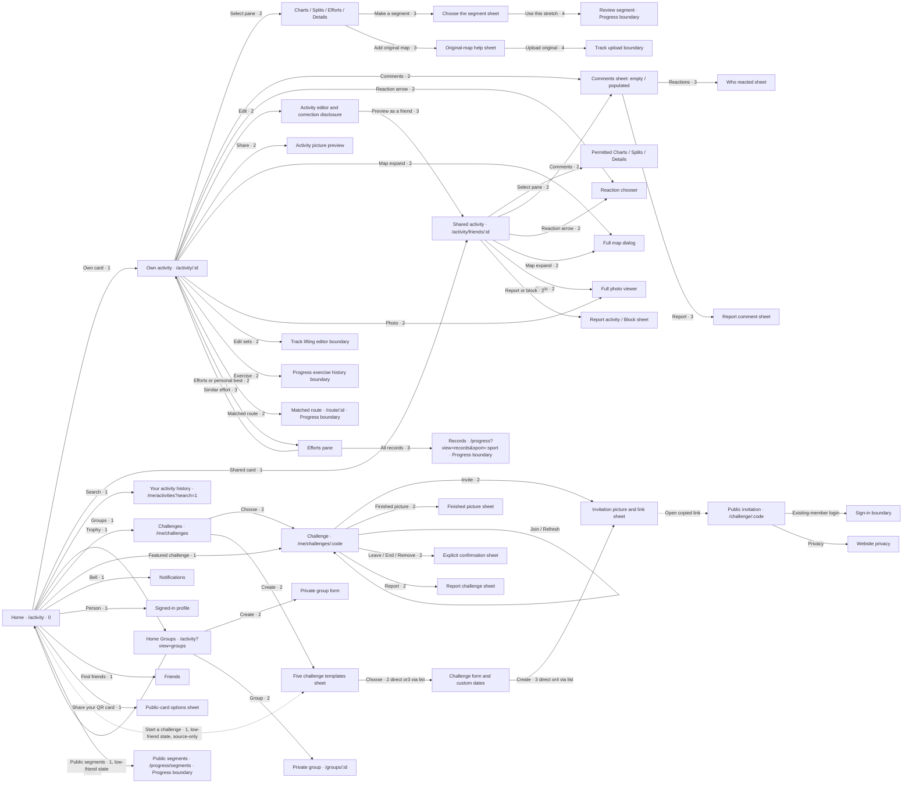

## Track

Depth starts on Track with the appropriate sport already selected. Recording and lifting summaries are states of existing routes. Native UI was inspected with local browser stand-ins; dashed plan/recovery arrows are source-only. A loaded interval selection also keeps the entrance available for removal when the selected activity changes.

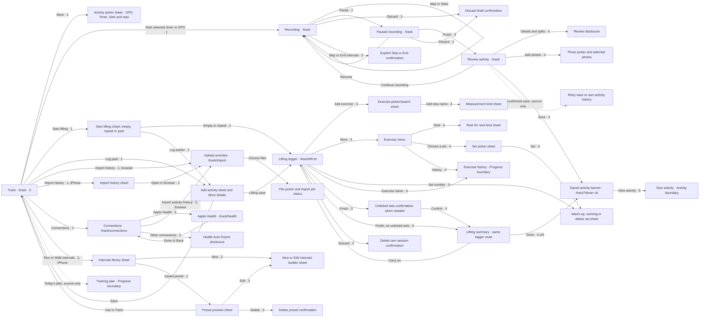

The Home and Track slices found no additional Speed Check entrance. The browser-only Health explanation is agreed to fold into Connections in the later shell batch, while full iPhone Health settings and independent consent scopes stay distinct. The application is unchanged by this map. Known layout and copy findings are tracked separately from this map.

## Progress

Seventeen owned route/view families include the plan and fixed-course flows below. Filters, chart modes and disclosures are states. Most detail pages take two taps; the deepest confirmed sheet takes four. Depth starts on Progress.

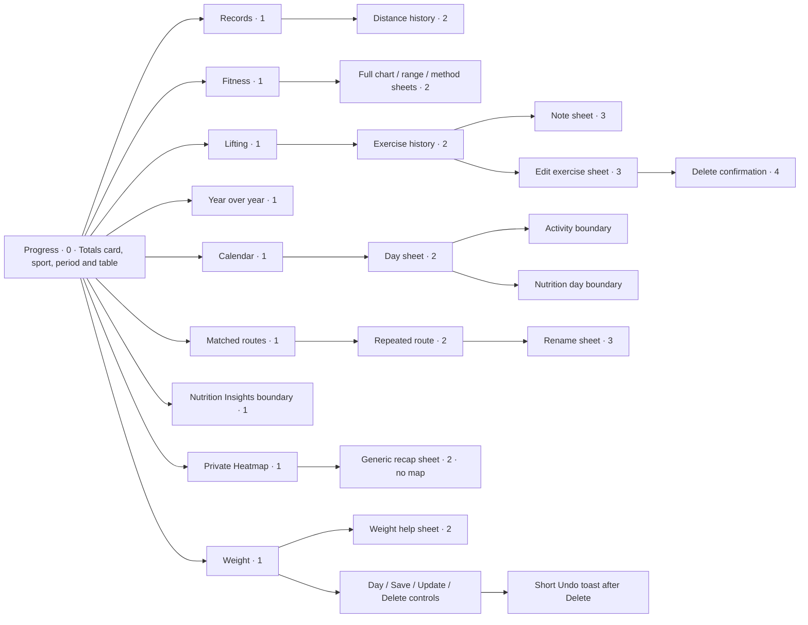

Record history, Fitness, exercise history and repeated routes link to their Activity source. Totals lives on Progress itself, with sport, period and table controls; old Totals/mileage URLs redirect there with their filters. Year over year has sport, range, table and chart controls. Record history has one fastest-first list with All and PRs filters. Weight also has a Nutrition entrance. Heatmap remains private; its recap contains no map. Weight deletion offers a short Undo toast, cancelling the deferred deletion without rewriting the original source or Health data; no extra sheet is involved. Other Progress correctness findings are tracked in #491. Totals folding into Progress and simpler repeated record lists are agreed for #492; this map retains the inspected pages until those changes ship.

### Fixed courses

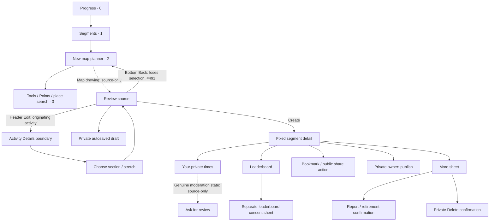

List controls include map, search, near, saved, mine and sport. Visibility and leaderboard consent remain separate. Interior-stretch selection, private draft restoration and creation were exercised. Header Edit returns to the originating activity, with `/segments/new` as its direct-load fallback. Bottom Back instead opens an empty planner: that defective return is tracked in #491. Consent, publication, retirement and moderation submission were not performed. Bookmark toggles directly; public sharing uses native/Web Share or clipboard, with native sharing unverified.

### Training plan

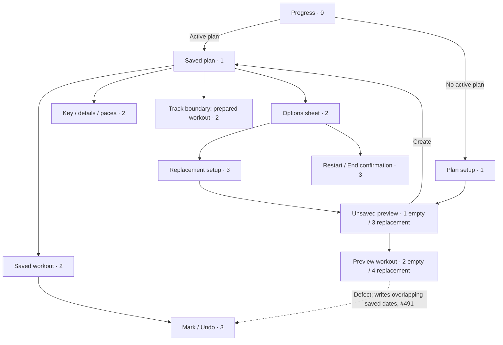

Race, level, length, days, date and goal are setup controls. The preview's completion write into an existing plan was verified and restored; the dashed arrow records a defect. Restart/End were inspected and cancelled. Start prepares Track without recording. Paid AI and physical recording remain unverified.

## Nutrition

Twelve canonical owned route/view families; day/origin parameters and import/setup variants are states. Depth starts on the food log. Nutrition details use an explicit Nutrition-parent Back, while `from=progress` preserves Progress. No additional Speed check entrance was found.

### Log, insights and targets

Weight has a direct one-tap entrance from the log and Insights; meal reminders link to Me in one tap. Expanded energy breakdown links to its Activity source.

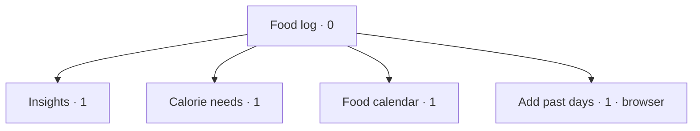

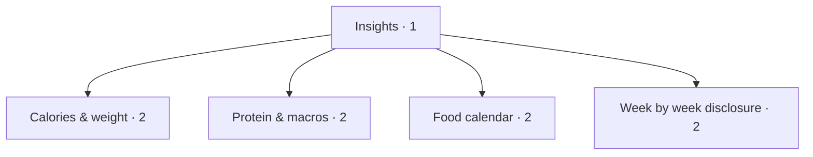

Insights also links to Calorie needs. Its Week by week disclosure covers 26 weeks independently of the selected chart range; old weekly links open that disclosure. Food calendar lists logged days newest first, including zero and unknown-calorie days. Choosing a listed day or using Open any day returns to that day's log. Goal preview can return to setup to change details, or Save/Not now back to the log.

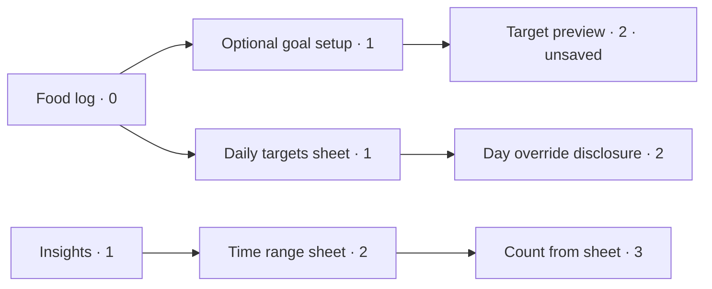

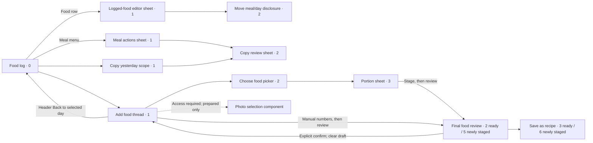

“Ready” means the review is already available in a restored thread; “newly staged” counts opening the picker, selecting a portion and staging it before final review. Manual review preserves semantic unknown nutrients. Search/describe/photo prepared results are UI evidence, not model accuracy. Photo selection was mounted locally and cancelled; native library/camera behavior and final thread Save-as-recipe remain unverified. Day, meal, portion and explicit confirmation remain distinct from editing reusable foods. Choose food keeps source tabs and portion selection; recipe creation stays in the library’s New action.

### Reusable recipes and foods

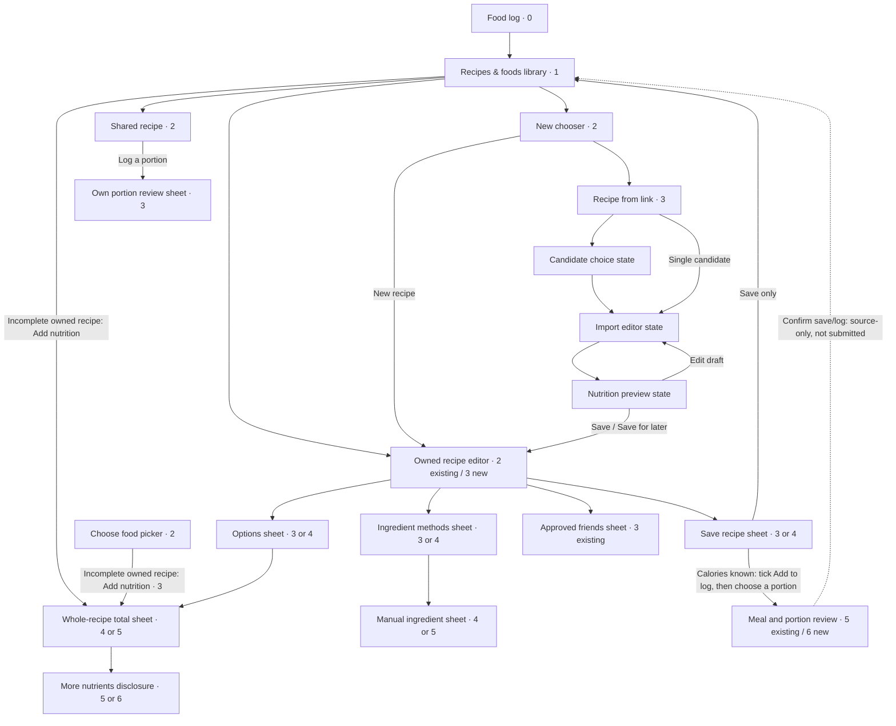

Library/import/setup use history-aware Back with named fallbacks. Import states share one URL; saving opens the owned recipe. Unknown calories prevent portion logging. Owned incomplete recipes offer Add nutrition; shared incomplete recipes explain that their owner must add it. Sharing/unsharing was checked with a fictional friend: access changed 404→200→404 while the owner's food log stayed unchanged. Shared access and each person's logged portions remain distinct. The deepest mapped disclosure takes six taps through a new recipe's Options and whole-recipe total.

The #493 fixes preserve unknown macros and clarify energy rows and food review. #494 unifies recipe rounding, labels chart/table bases, keeps history dates fixed, folds Week by week into Insights and simplifies Food calendar and the food chooser. This map includes those implementation changes. Native Health, moderation, external recipes and paid processing remain boundaries.

## Sign-up, recovery and welcome

Nine route families: `/`, `/signup`, `/beta`, `/join/:token`, `/add/:code`, `/forgot-password`, `/reset-password/:token`, `/confirm-email/:token` and `/welcome`. Login, initial-admin setup, install guidance and temporary-password recovery share `/`; welcome steps and Terms/photo overlays are states. Depth here starts at anonymous/direct entry rather than a tab.

### Entry and recovery

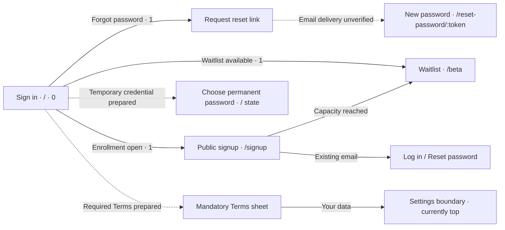

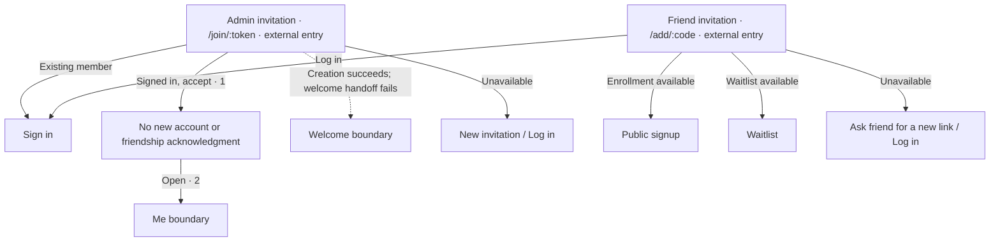

Forgot password's login link opens an inline state without changing `/`; direct `/forgot-password` also works. Invalid reset's Send new link similarly replaces its URL with `/`, then explicit Back returns login. A friend link does not override closed enrollment. New-account invitation creation succeeded, but a retained consumed-invitation return interrupts welcome: original timeout, labelled replay and fresh-login recovery are separate evidence. Existing-account acceptance and acknowledgment passed without creating a friendship.

Public enrollment/cap/waitlist, active Terms, valid reset and temporary-password screens used labelled browser stand-ins. The inspected server had Terms disabled. No email, password change or Terms acceptance was performed; initial-admin creation is source-only. Received invitation/reset/confirmation URLs start at zero external-entry taps.

### Welcome

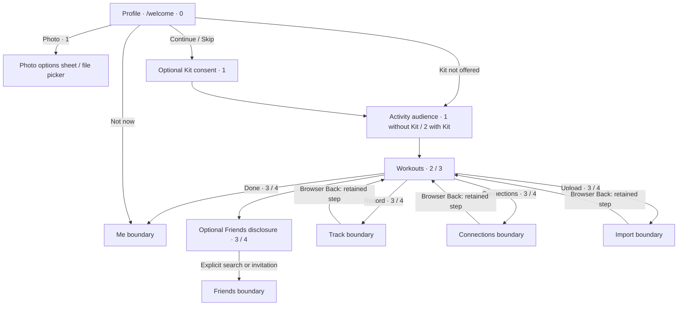

Not now is available throughout welcome and returns Me. Profile and audience Save/readback/restore or Skip were checked, with Kit skipped without consent. Audience choice remains separate from optional Kit's 18+ data consent. The semantic welcome step survives the workouts-boundary returns. Friends is optional within workout setup; completing setup never sends a friend request. A first fictional upload through Import created one Only-me activity; another fictional account could not read its shared endpoint. Native Health/install visuals were prepared, without permissions or store actions. Photo options were opened/cancelled without selecting a photo.

The #496 handoff, invited 16+ confirmation and invite-page clipping fixes are merged. #497 makes privacy and estimate wording precise, labels save/skip/leave actions, conditions Garmin and install copy, clarifies recovery/Terms/import copy, folds Friends into setup and retains the welcome step. Keep secure recovery, admin/friend invitations, explicit activity audience and separate Kit consent distinct. The map documents current behavior; it does not approve page removals or policy changes.
