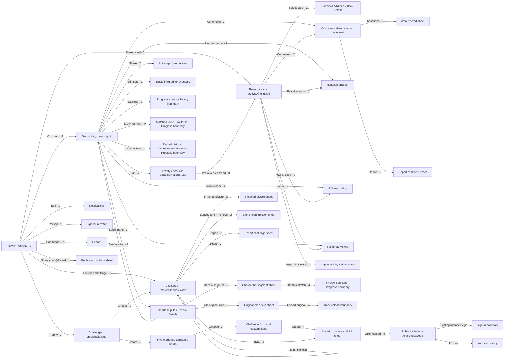
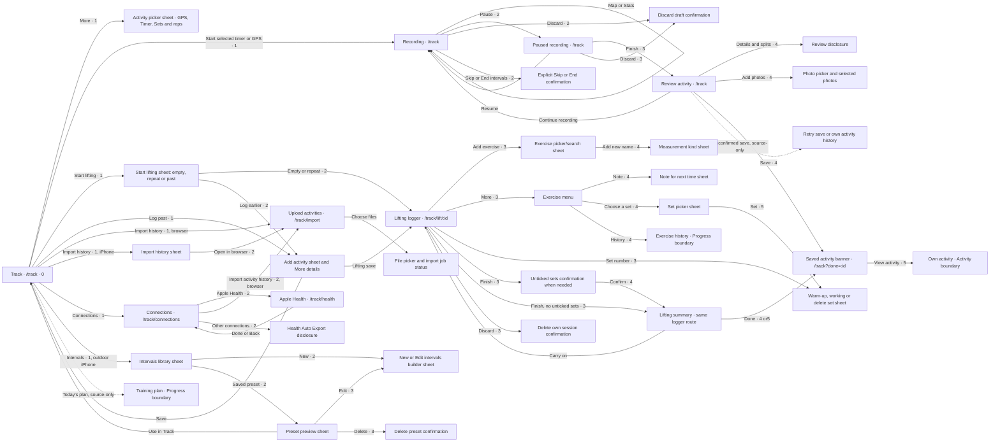

# Kinetta app map

The pre-launch walkthrough (#472) builds this map one tab at a time. Me was inspected at `8cb2c01`, and Activity and Track at `7d0b3d6`. Track’s native recording and Health visuals used browser stand-ins; physical-device behavior is not verified. Progress, Nutrition and sign-up interiors remain for their walkthroughs. Routes use placeholders and contain no account data.

Depth counts taps after selecting the tab. Opening a disclosure and then its Open link counts as two taps. Sheet depth is included. Scrolling does not add taps. A node can have several entrances; depths below use the shortest entrance available in the inspected state.

## Me and the five-tab spine

The boundary nodes lead to other tabs; their owned flows appear below as each slice is reviewed.

```mermaid
flowchart LR
  Tabs["Five tabs"] --> Me["Me · 0 taps"]
  Tabs --> Activity["Activity · see audited flow below"]
  Tabs --> Track["Track · see audited flow below"]
  Tabs --> Progress["Progress · future slice"]
  Tabs --> Nutrition["Nutrition · future slice"]
  Signup["Sign-up and welcome · future slice"]

  Me -->|Settings icon · 1| Settings["Settings · /me/settings"]
  Me -->|Avatar or shared count · 1| Profile["Your full profile · /people/:username"]
  Me -->|Friends · 1| Friends["Friends · /me/friends"]
  Me -->|Bell · 1| Inbox["Notification inbox · /notifications"]
  Me -->|All your activities · 1| History["Your activities · /me/activities"]
  Me -->|Shoes and bikes · 1| Gear["Shoes and bikes · /me/gear"]
  Me -->|Goals Edit · 1 when goals exist| Goals["Goals · /me/goals"]
  Me -->|Recent milestones · 1 when present| Milestones["Recent milestones · /me/milestones"]
  Me -->|Explore · 1| Explore["Explore Kinetta · /me/explore"]
  Me -->|Edit · 1| Editor["Inline card editor"]
  Me -->|Share · 1| ShareMenu["Share your profile sheet"]
  Me -->|Monthly recap Share · 1 when present| Recap["Share progress sheet"]
  Me -->|Weekly review disclosure · 1| Week["Your week in review · inline"]
  Me -->|Optional profile setup · 1| Signup
  Me -->|Training plan or View plan · 1| Plan["Training plan · /plan"]
  Me -->|View progress or Fitness · 1| Progress
  Me -->|Open food log or Food review · 1| Nutrition
  Me -->|Log food · 1| AddFood["Add food · /food/describe"]
  Me -->|Nutrition goal · 1| FoodSetup["Nutrition goal · /food/setup"]
  Me -->|Today workout or personal best · 1| Detail["Activity detail · /activity/:id"]
  Me -->|Optional connection setup · 1| Connections["Connections · /track/connections"]
  Me -->|Record an activity · 1| Track
  Me -->|Help| Mail["Help and contact · email link"]

  Settings -->|Name · 2| Name["Name sheet"]
  Settings -->|Username · 2| Username["Username sheet"]
  Settings -->|Email · 2| Email["Email sheet · setup-dependent"]
  Settings -->|Password · 2| Password["Change password sheet"]
  Settings -->|Edit profile · 2| Editor
  Settings -->|Body and heart rate · 2| Body["Body, heart rate and time-zone sheet"]
  Body -->|Log · 3| Weight["Weigh-in sheet"]
  Settings -->|Signed-in devices · 2| Devices["Signed-in devices · /me/devices"]
  Devices -->|Sign out one or others · 3| SignoutConfirm["Device sign-out confirmation"]
  Settings -->|Sharing and privacy · 2| Privacy["Sharing and privacy · /me/sharing"]
  Privacy -->|Segment leaderboards · 3| SegmentConsent["Segment leaderboard consent sheet"]
  Settings -->|Notifications · 2| NoticePrefs["Notification preferences · /me/notifications"]
  Settings -->|Connections · 2| Connections
  Settings -->|Kit explanation · 2| KitInfo["What gets shared sheet"]
  Settings -->|AI On · 2| KitConsent["Kit consent sheet"]
  Settings -->|What Kit remembers · 2| Memory["Memory settings sheet"]
  Settings -->|Download my data · 2| Export["Own-data ZIP download"]
  Settings -->|Delete account · 2| Delete["Delete-account confirmation sheet"]
  Settings -->|Terms or Privacy · 2| Policies["Website policies · new browser tab"]
  Settings -->|Speed check · 2| Speed["Speed check · /me/speed"]
  Settings -->|Log out · 2| Login["Sign-in screen · future slice"]
  Settings -->|Help| Mail

  Editor -->|Change photo · 2, or 3 through Settings| Photo["Profile photo sheet and file picker"]
  Editor -->|Sections, order, numbers, sports| Editor
  Editor -->|Save or Cancel| Me
  Profile -->|Edit · 2| Editor
  Profile -->|Share · 2| ShareMenu
  Profile -->|Friends · 2| Friends
  Profile -->|Find people · 2| Friends
  Profile -->|Preview friends or other members| Profile
  Profile -->|Shared workout · 2| SharedDetail["Shared activity · /activity/friends/:id"]
  Profile -->|Choose an activity in empty state · 2| History

  ShareMenu -->|Share profile link · 2| SystemShare["Browser share or copy fallback"]
  ShareMenu -->|View full profile · 2| Profile
  ShareMenu -->|Public card and QR · 2| PublicCard["Public card options sheet"]
  PublicCard -->|Show QR · 3| QR["QR screen"]
  PublicCard -->|Make new link · 3| Rotate["Revoke old link confirmation"]
  PublicCard -->|Copy or Share| SystemShare
  QR -.->|Scan or open copied URL| CardPreview["Public card · /card/:code"]
  CardPreview -.->|Join or request friendship| Signup
  Recap -->|Preview picture · 2| RecapPicture["Full-size progress picture sheet"]
  Recap -->|Periods and included facts| Recap
  Recap -->|Share| SystemShare
  Milestones -->|More · 2| MilestoneList["Milestone list sheet"]
  Milestones -->|Share · 2| MilestoneShare["Share milestone sheet"]
  MilestoneList -->|Choose one · 3| MilestoneShare
  MilestoneShare -->|Share| SystemShare

  Friends -->|Search or Browse| Friends
  Friends -->|Person · 2| OtherProfile["Another member's profile · /people/:username"]
  Friends -->|Manage friendship · 2| FriendMenu["Friendship actions sheet"]
  FriendMenu -->|Remove or Block · 3| FriendConfirm["Remove or block confirmation sheet"]
  Friends -->|Incoming request menu · 2| RequestMenu["Incoming request actions sheet"]
  RequestMenu -->|Block · 3| FriendConfirm
  Friends -->|Invite · 2| Invite["Private friend invitation sheet"]
  Invite -->|Use your card · 3| PublicCard
  Invite -->|Copy| SystemShare
  Friends -->|Sharing · 2| Privacy
  Inbox -->|Workout or comment · 2| Detail
  Inbox -->|Friend request · 2| Friends

  History -->|Search, sport, Show more| History
  History -->|Workout · 2| Detail
  Gear -->|Add or edit · 2| GearEdit["Gear editor sheet"]
  GearEdit -->|Delete · 3| GearDelete["Delete-gear confirmation"]
  Gear -->|Delete row · 2| GearDelete
  Goals -->|Add · 2, or 4 through Explore| GoalEdit["New goal sheet"]
  Goals -->|Remove and Undo| Goals

  Explore -->|Feature disclosure · 2| GuideEntry["Feature details · inline"]
  Explore -->|Search and categories| Explore
  Kit["Ask Kit · /me/kit"]
  Challenges["Challenges · Activity-owned /me/challenges"]
  GuideEntry -->|"Open Welcome to Kinetta"| Signup
  GuideEntry -->|"Open Personal estimates"| Body
  GuideEntry -->|"Open Apple Health"| GuidePage1
  GuideEntry -->|"Open Watch connections"| Connections
  GuideEntry -->|"Open Bring in activity history"| GuidePage2
  GuideEntry -->|"Open Log food without AI"| AddFood
  GuideEntry -->|"Open My Recipes"| GuidePage3
  GuideEntry -->|"Open Meal portions and sharing"| GuidePage3
  GuideEntry -->|"Open Nutrition targets"| Nutrition
  GuideEntry -->|"Open Calories and weight"| GuidePage4
  GuideEntry -->|"Open Protein and macros"| GuidePage5
  GuideEntry -->|"Open Calorie needs"| GuidePage6
  GuideEntry -->|"Open Food overview and weekly totals"| GuidePage7
  GuideEntry -->|"Open Import earlier food and weight"| GuidePage8
  GuideEntry -->|"Open Weekly review and calorie check-in"| Nutrition
  GuideEntry -->|"Open Nutrition reminders and Health sync"| NoticePrefs
  GuideEntry -->|"Open Offline food entries and Undo"| AddFood
  GuideEntry -->|"Open Nutrient details"| Nutrition
  GuideEntry -->|"Open Training plans"| Plan
  GuideEntry -->|"Open Run/walk intervals"| GuidePage9
  GuideEntry -->|"Open Track an activity"| Track
  GuideEntry -->|"Open Live pace, laps and auto-pause"| Track
  GuideEntry -->|"Open GPS distance and watch duplicates"| Track
  GuideEntry -->|"Open Log strength workouts"| Track
  GuideEntry -->|"Open Lifting history and records"| GuidePage10
  GuideEntry -->|"Open Activity details"| History
  GuideEntry -->|"Open Share an activity picture"| History
  GuideEntry -->|"Open Full-screen maps"| History
  GuideEntry -->|"Open Pace, GAP and effort"| History
  GuideEntry -->|"Open Weekly, monthly and yearly totals"| Progress
  GuideEntry -->|"Open Fitness and freshness"| GuidePage11
  GuideEntry -->|"Open Personal records"| GuidePage12
  GuideEntry -->|"Open Weight trend"| GuidePage13
  GuideEntry -->|"Open Calendar"| GuidePage14
  GuideEntry -->|"Open Matched routes"| GuidePage15
  GuideEntry -->|"Open Heatmap"| GuidePage16
  GuideEntry -->|"Open Year-over-year trends"| GuidePage17
  GuideEntry -->|"Open Recent milestones"| Milestones
  GuideEntry -->|"Open Share your progress"| Progress
  GuideEntry -->|"Open Fitness, fatigue and form defined"| GuidePage11
  GuideEntry -->|"Open VDOT and race predictions"| GuidePage11
  GuideEntry -->|"Open Challenges"| Challenges
  GuideEntry -->|"Open Share your Kinetta"| Me
  GuideEntry -->|"Open Friends and people search"| Friends
  GuideEntry -->|"Open Cheers and comments"| GuidePage18
  GuideEntry -->|"Open Your shared profile"| Me
  GuideEntry -->|"Open Sharing and map privacy"| Privacy
  GuideEntry -->|"Open Shoes and bikes"| Gear
  GuideEntry -->|"Open Goals"| Goals
  GuideEntry -->|"Open Notifications"| NoticePrefs
  GuideEntry -->|"Open Units and time zone"| Body
  GuideEntry -->|"Open Your data"| Settings
  GuideEntry -->|"Open Signed-in devices and safety emails"| Devices
  GuideEntry -->|"Open Settings and account"| Settings
  GuideEntry -->|"Open Refresh and return"| Me
  GuideEntry -->|"Open Describe what you ate"| AddFood
  GuideEntry -->|"Open Food estimates and nutrition labels"| AddFood
  GuideEntry -->|"Open Ask Kit and memory"| Kit
  GuideEntry -->|"Open Kit training and nutrition reviews"| Me
  GuidePage1["/track/health · first destination only"]
  GuidePage2["/track/import · first destination only"]
  GuidePage3["/food/meals · first destination only"]
  GuidePage4["/food?view=energy · first destination only"]
  GuidePage5["/food?view=macros · first destination only"]
  GuidePage6["/food?view=needs · first destination only"]
  GuidePage7["/food?view=weeks · first destination only"]
  GuidePage8["/food/import · first destination only"]
  GuidePage9["/track?intervals=1 · first destination only"]
  GuidePage10["/progress?view=lifting · first destination only"]
  GuidePage11["/progress?view=fitness · first destination only"]
  GuidePage12["/progress?view=records · first destination only"]
  GuidePage13["/progress/weight?from=explore · first destination only"]
  GuidePage14["/progress/calendar · first destination only"]
  GuidePage15["/progress/routes · first destination only"]
  GuidePage16["/progress/heatmap · first destination only"]
  GuidePage17["/progress/trends · first destination only"]
  GuidePage18["/activity · first destination only"]
  Kit -->|More · 4 through Explore| KitMenu["Kit chat settings sheet"]
  Kit -->|Memory · 4 through Explore| Memory
  KitMenu -->|Memory · 5 through Explore, or 2 via Settings| Memory
  KitMenu -->|Earlier reviews · 5 through Explore| SavedReviews["Earlier Kit reviews sheet"]
  KitMenu -->|Kit and data permissions| Me

  classDef boundary fill:#e8edf4,stroke:#74839a,color:#15191d
  class Activity,Track,Progress,Nutrition,Signup,Login,Plan,Detail,SharedDetail,FoodSetup,AddFood,Connections,Challenges boundary
```

The Me walkthrough covers Me pages and sheets. A link into another tab is checked through its first destination and return; activity-card internals and those tabs' full journeys belong to their later slices. The map will expand with each reviewed slice.

Observed return exceptions: Explore's four Add-food entries and four Nutrition view links first return to Nutrition; Challenges returns to Activity; Ask Kit returns to Me. The Kit permissions link currently points to Me's old `#ai` location. Returning to a parent tab is the accepted navigation behaviour. The stale Kit permissions destination is tracked in #418.

## Me page summary

The inspected slice includes 15 app pages (Me, Settings, sharing/privacy, notification preferences, devices, Speed check, Gear, Goals, Friends, full profile, activity history, Explore, milestones, Ask Kit and the notification inbox), plus the public-card landing and their sheets.

| Destination | Shortest observed entrance from Me | Taps |
|---|---|---|
| Profile editor, Friends, Settings, history, Gear, Explore | Direct visible entry | 1 |
| Body settings, devices, privacy, notification preferences, Speed check | Settings, then row | 2 |
| Public card options / QR | Share, public card / Show QR | 2 / 3 |
| New Goal with no existing goals | Explore, Goals disclosure, Open, Add | 4 |
| Earlier Kit reviews in the inspected unavailable state | Explore, Ask Kit disclosure, Open, More, Earlier reviews | 5 |

The measured entrance depends on account state: populated goals and recent milestones have direct Me entries. A view reached by an Explore disclosure takes three taps before any controls inside it.

## Follow-up decisions

Speed check and its Settings link are scheduled for retirement in #486; the diagram records their current presence. A direct first-Goal entrance belongs to #421. Kit permissions/history depth belongs to #418. Merging Recent milestones into Me remains a proposal awaiting an owner decision. Private history and shared profiles retain separate entrances, as do signed-in profile links and public card/QR sharing.

## Activity

Depth starts on Activity. Own and shared activity routes keep different audiences; panes and sheets are not extra pages.

## Track

Depth starts on Track with the appropriate sport already selected. Recording and lifting summaries are states of existing routes. Native UI was inspected with local browser stand-ins; dashed plan/recovery arrows are source-only.

The Activity and Track slices found no additional Speed Check entrance. The browser-only Health explanation is agreed to fold into Connections in the later shell batch, while full iPhone Health settings and independent consent scopes stay distinct. The application is unchanged by this map. Known layout and copy findings are tracked separately from this map.
