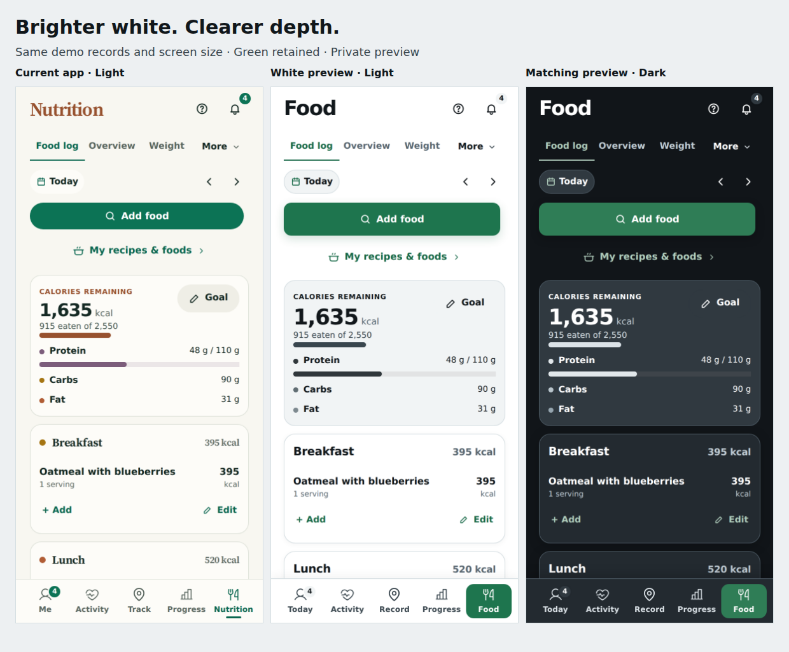
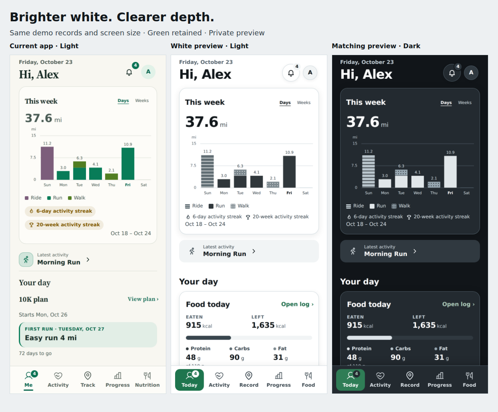
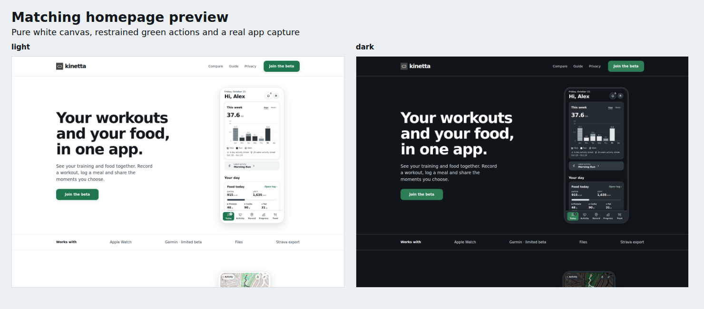
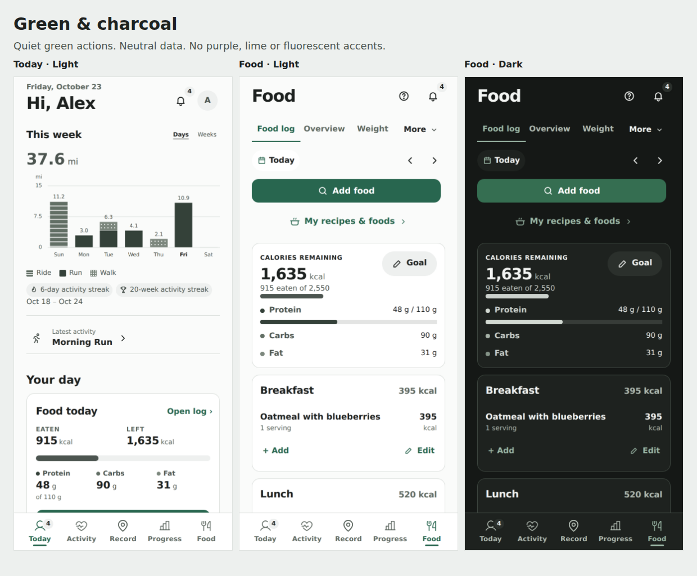
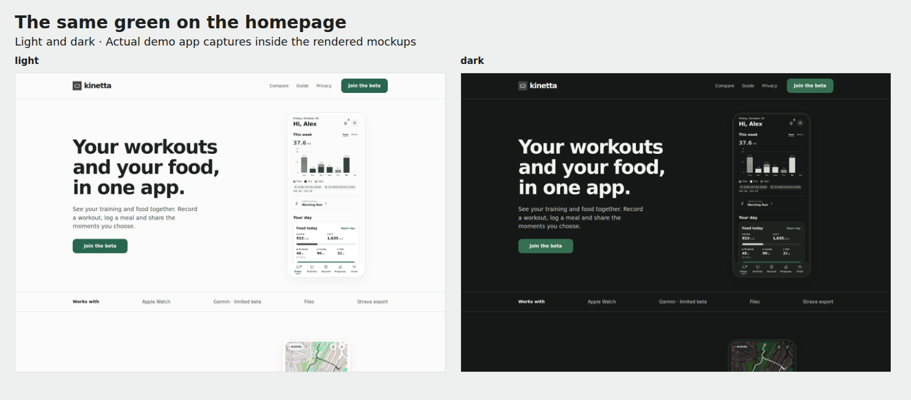
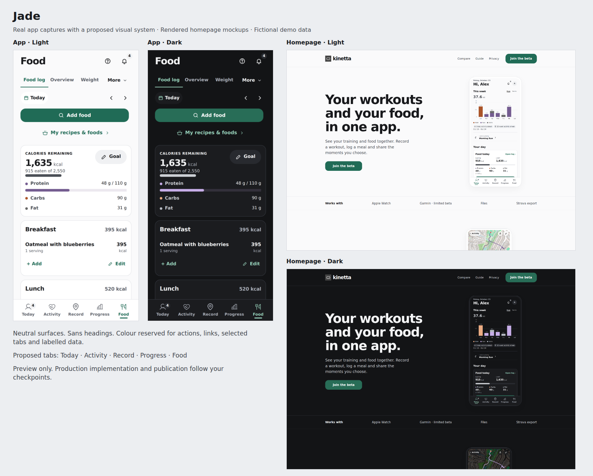
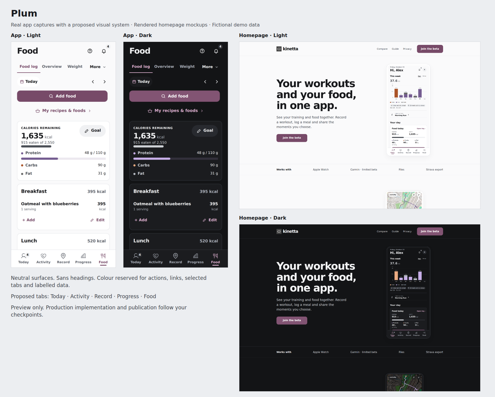
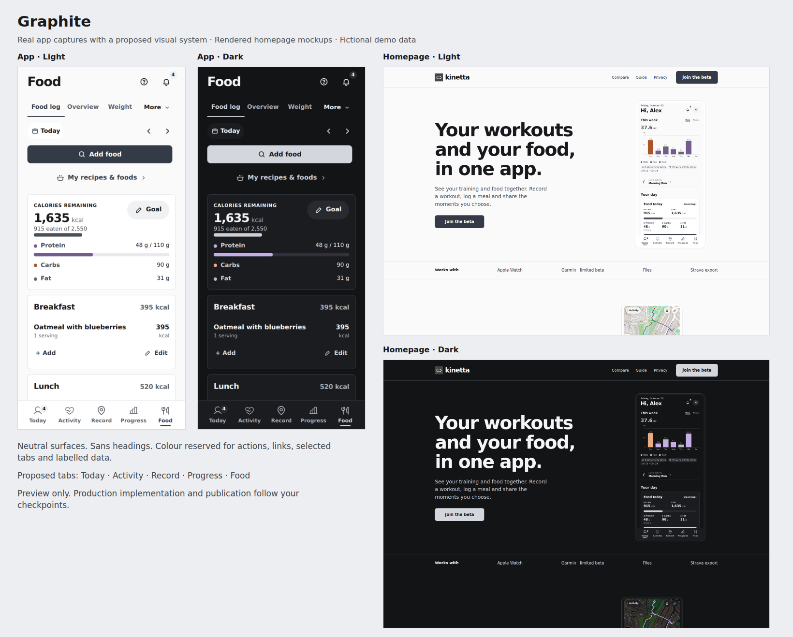

# Kinetta: design choices for review

**23 October 2026 · Review only. No direction is approved.** This PR adds review documents and screenshots only. It does not change the app, website, shared tokens, design guide, native bundles or running services. Please leave it in draft while reviewing.

The latest feedback is: green is welcome, neon green and purple are not; the off-white app feels flat and may need a brighter background. E is the response to that feedback, not a selected winner. A–D remain here because the request is to show every choice, including those already rejected.

[Open the portable gallery](index.html) after downloading this folder. GitHub displays the images and Markdown below; it does not run the HTML gallery. Every direction includes actual app captures with preview styling and rendered homepage mockups, in light and dark. People, activities and food are fictional demo data. These are proposals, not App Store exports or deployed screens.

## All choices

| Choice | What it explores | Review status | Full screenshots |
| --- | --- | --- | --- |
| A · Jade | Neutral surfaces, green actions, coloured chart data | Rejected | [App and homepage](images/a-jade/) |
| B · Plum | Neutral surfaces with a plum brand colour | Rejected; conflicts with the current no-purple preference | [App and homepage](images/b-plum/) |
| C · Graphite | Neutral actions and surfaces, coloured chart data | Rejected | [App and homepage](images/c-graphite/) |
| D · Green & charcoal | Restrained green actions, neutral data with sport patterns | Rejected after the second round | [App and homepage](images/d-green-charcoal/) |
| E · Brighter white & green | Pure-white light canvas, darker figures, clearer panels and green selection | Latest proposal; unapproved | [App and homepage](images/e-brighter-white/) |

The earlier [colour draft, PR #219](https://github.com/BenCBanks/kinetta/pull/219), is separate historical context. None of these choices approves, replaces or merges that PR automatically.

### E · Brighter white & green — latest proposal

Food: current app → proposed light → proposed dark.

Today: current app → proposed light → proposed dark.

Homepage, light and dark.

[Full light homepage](images/e-brighter-white/light-home-full.png) · [Full dark homepage](images/e-brighter-white/dark-home-full.png) · [Mobile light](images/e-brighter-white/light-home-phone.png) · [Mobile dark](images/e-brighter-white/dark-home-phone.png)

E is more than a hue change: white replaces ivory, near-black values have more weight, the weekly summary gains a fine outline and restrained depth, the food summary gets a distinct neutral surface, and the selected tab is filled green. Dark mode uses neutral charcoal layers. The preview also puts conditional Food before the conditional plan, without removing either; that ordering is a separate unapproved choice. The tradeoff is more panel emphasis and visual weight; review density and whether the shadows feel excessive. Chart data is neutral and needs careful checking for quick identification. Map tiles contain geographic colours outside the app palette; this is not a promise of a completely monochrome map.

### D · Green & charcoal — rejected

### A · Jade — rejected

### B · Plum — rejected

### C · Graphite — rejected

## Two approval checkpoints

1. Select or refine the app/site visual direction **before implementation**. Nothing is selected by this PR.
2. Review and approve the homepage mockup **before publication**, separately from the visual-direction decision.

## Decisions to record

A preference on one row does not approve the other rows. “None yet” remains a valid answer.

| Decision | Choices for review | Current status |
| --- | --- | --- |
| Visual foundation | A–E, a combination, or none yet | No selection; latest owner preference favours testing white with green |
| Light background | Pure white as in E, versus the earlier near-white treatments | Unapproved |
| Depth | Fine borders only; restrained panel/button shadows as in E; another treatment | Unapproved |
| Data encoding | Small distinct palette restricted to data; neutral shades plus patterns | Unapproved encoding; no purple or neon is the owner’s stated preference |
| Tabs | Proposed Today · Activity · Record · Progress · Food; retain current arrangement; revise after task testing | Unapproved; screenshots change labels only, not routes or account architecture |
| Homepage story | One homepage with Training, Food and Friends sections; retain Compare, Guide, Privacy | Mockup unapproved; publication requires its own checkpoint |
| First run | Optional device connection, then one goals question; later setup must remain available | Flow proposal only; not built |
| Launch scope | Finish each remaining item, or explicitly defer it with the owner | No automatic cuts or launch approval |

The original brief calls for a neutral white/near-white base without cream; near-black text; modern sans headings; one calm brand colour for main buttons, selection and links; data colours only in charts/data; and no decorative coloured words, eyebrow labels or orbits. Errors and destructive controls still need meaningful, accessible warning treatment. Review must not silently remove those semantics.

## Review packet

- [External research: findings, sources and limits](RESEARCH.md).
- [Full app and launch review: proposed work, priorities and acceptance evidence](REVIEW-SCOPE.md).
- [Completed Claude review and follow-up notes](CLAUDE-REVIEW.md), with the [original review brief](CLAUDE-REVIEW-BRIEF.md). Recommendations remain unapproved.
- [Verification and remaining limits](VERIFICATION.md).
- [Current app light/dark reference](images/current/).

The screenshots retain their original historical captions, including “private preview.” They were made privately; inclusion in this public review PR makes the curated copies public. No account/session exports, raw test logs, credentials, private infrastructure inventory or real user records are included.

After the owner selects a direction, a separate implementation should change the shared token source once, keep the readability checks, update the design guide, and verify the app and website together. Do not use this review PR as implementation authorization. Homepage publication, merge, deployment and App Store submission remain separate steps.
